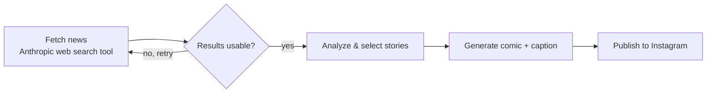

# Comic News Generator

An automated news-reporting pipeline built with **Spring Boot** and **Spring AI**. It researches current news with Anthropic's web search tool, turns stories into comic-style posts with captions, and publishes them to Instagram.

**See it live:** [@TODO-handle on Instagram](https://instagram.com/TODO-handle)

## Sample output

<!-- Add 1–2 example posts here, e.g. docs/images/sample-1.png -->


## Why I built it

A research project in automated news reporting: can an LLM-driven pipeline reliably gather real news, check what it found, and turn it into shareable content without manual steps in between?

## How it works



1. **Fetch** — Calls Claude with Anthropic's web search tool to gather current stories and their sources.
2. **Validate & retry** — Checks the returned results and re-queries when they come back thin or off-target.
3. **Analyze** — TODO: how stories are selected and summarized.
4. **Generate** — TODO: how the comic and caption are produced (which model/API).
5. **Publish** — TODO: automated via API, or prepared for manual upload.

## Design decisions

**Web search tool over RSS feeds or page scraping.** News comes back as structured model output rather than raw HTML or a fixed feed, so the app can inspect what it gathered, retry when results are weak, and analyze stories before generating anything. Scraping would mean maintaining a parser per site; RSS would limit coverage to whatever feeds were configured.

## Tech stack

| Area | Technology |
|---|---|
| Language | Java TODO |
| Framework | Spring Boot TODO, Spring AI TODO |
| LLM & search | Anthropic Claude API + web search tool |
| Build | Maven |
| Publishing | Instagram |

## Getting started

**Prerequisites:** Java TODO+, an Anthropic API key.

```bash
git clone https://github.com/TODO-username/comic-news-generator.git
cd comic-news-generator
export ANTHROPIC_API_KEY=your-key
./mvnw spring-boot:run
```
